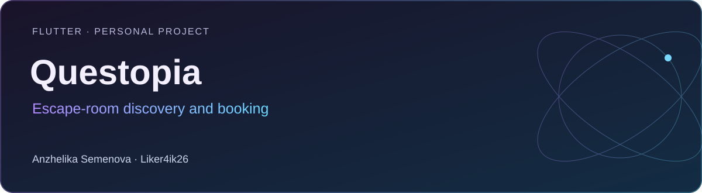
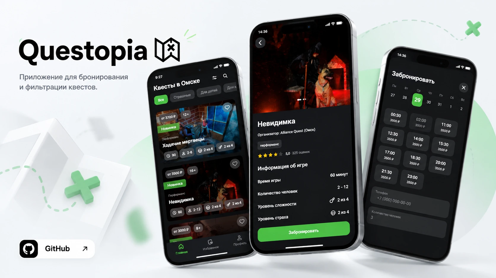
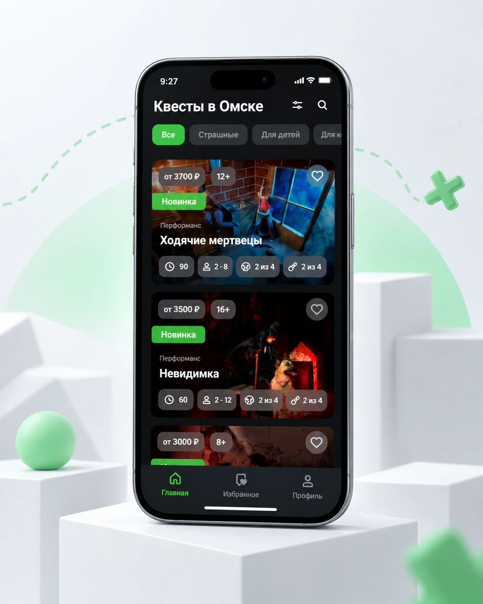
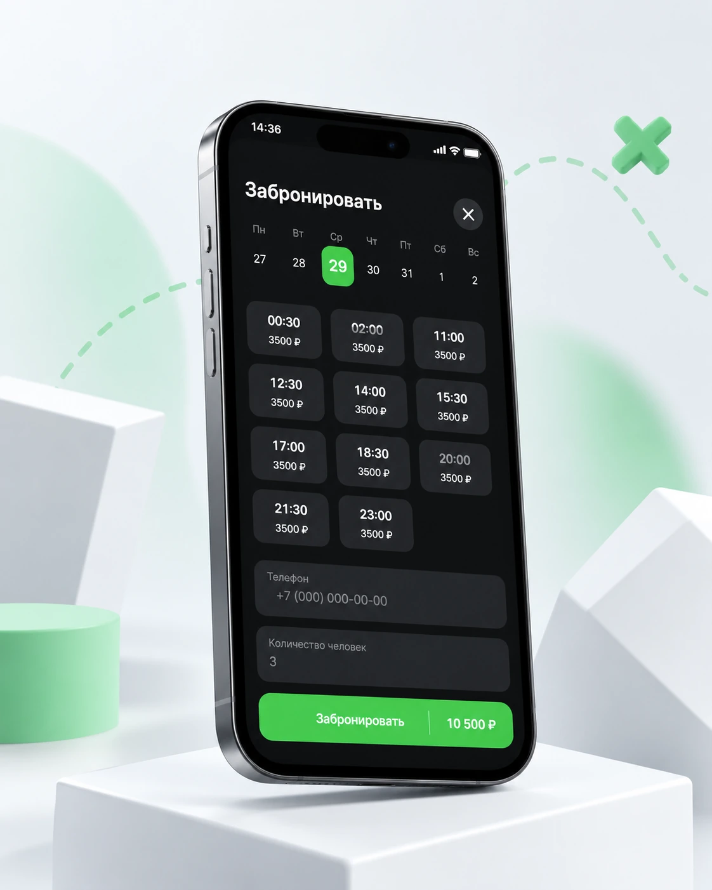
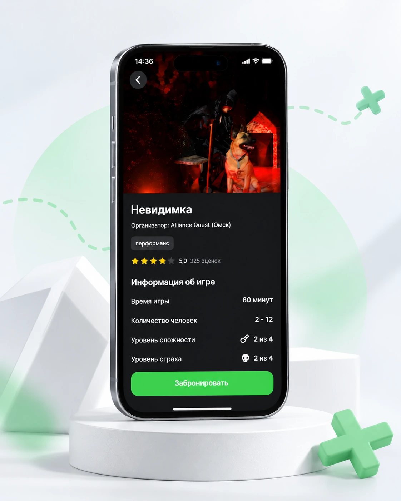

# Questopia

**Flutter · Personal project** · Flutter · Dart · BLoC / Cubit · GoRouter · Supabase · Hive · Dio

Приложение для поиска и бронирования квестов: от выбора приключения до управления записью и избранным.

[Портфолио автора](https://portfolio.semenova-anzhelika.online/) · [Профиль GitHub](https://github.com/Liker4ik26) · [Исходники](https://github.com/Liker4ik26/questopia/tree/main)

> Полная реализация находится в ветке main. Ветка master содержит раннюю основу проекта; команда клонирования ниже сразу выбирает main.

## Как выглядит проект



| Каталог и поиск | Интерфейс приложения | Пользовательские сценарии |
| :---: | :---: | :---: |
|  |  |  |

Изображения взяты из [моего сайта-портфолио](https://portfolio.semenova-anzhelika.online/#personal).

## Что в проекте

- Каталог квестов, карточки с подробностями и фильтры.
- Выбор даты и времени, оформление и отмена бронирования.
- Авторизация, регистрация и профиль пользователя.
- Избранное в Hive, работа с Supabase и локальными уведомлениями.

## Технологии

| Направление | Реализация |
| :--- | :--- |
| Стек | Flutter · Dart · BLoC / Cubit · GoRouter · Supabase · Hive · Dio |
| Формат | Flutter · Personal project |
| Окружение | Dart >=3.1.3 <4.0.0; совместимый Flutter SDK |

## Где смотреть код

- lib/core/ — приложение, общие компоненты, репозитории и локальная база
- lib/ — экраны и пользовательские сценарии; точное дерево смотрите в main
- android/ — Android-конфигурация

## Как запустить

Требования: Dart >=3.1.3 <4.0.0; совместимый Flutter SDK.

```bash
git clone --branch main https://github.com/Liker4ik26/questopia.git
cd questopia
flutter pub get
```

Подготовьте собственный проект Supabase и локальную конфигурацию .env по обращениям в lib/main.dart ветки main. Используйте свои параметры подключения; доступность демонстрационного сервера не гарантируется.

```bash
flutter run
```

## English overview

**Questopia — Escape-room discovery and booking.**

Flutter · Personal project. Stack: Flutter · Dart · BLoC / Cubit · GoRouter · Supabase · Hive · Dio. The full application source is in the `main` branch. [Explore my professional portfolio](https://portfolio.semenova-anzhelika.online/).

---

**Автор — Анжелика Семёнова · [Liker4ik26](https://github.com/Liker4ik26)**

[Сайт](https://portfolio.semenova-anzhelika.online/) · [Telegram](https://t.me/Liker4ik50) · [Почта](mailto:pr110oat18@gmail.com)
